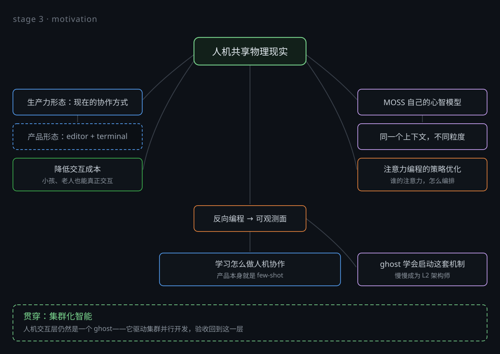
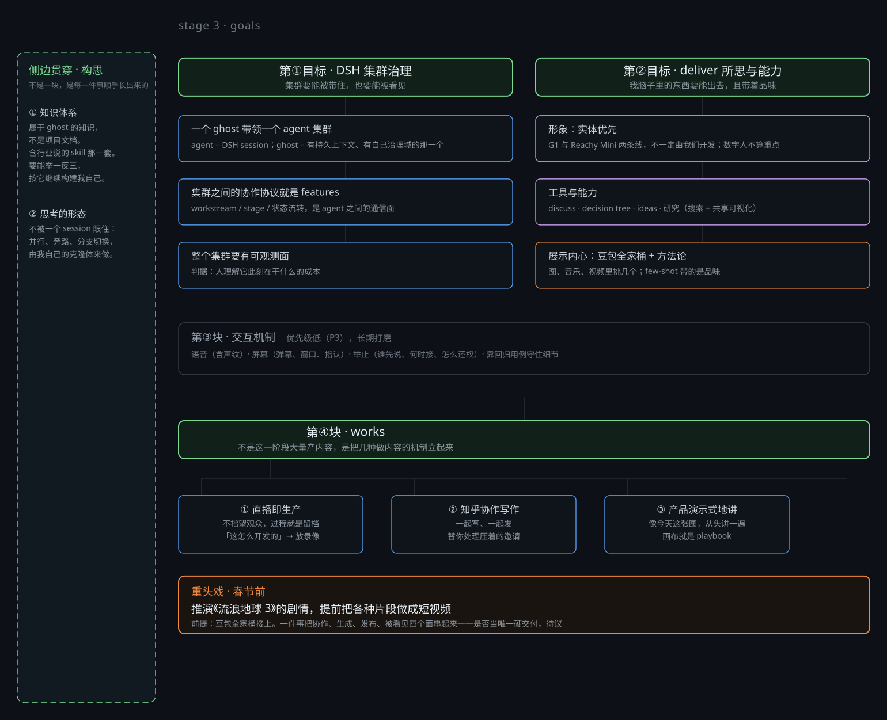
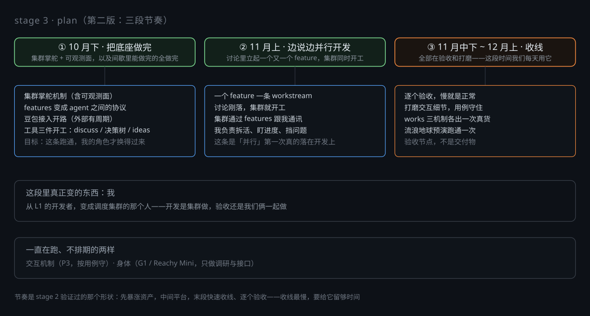
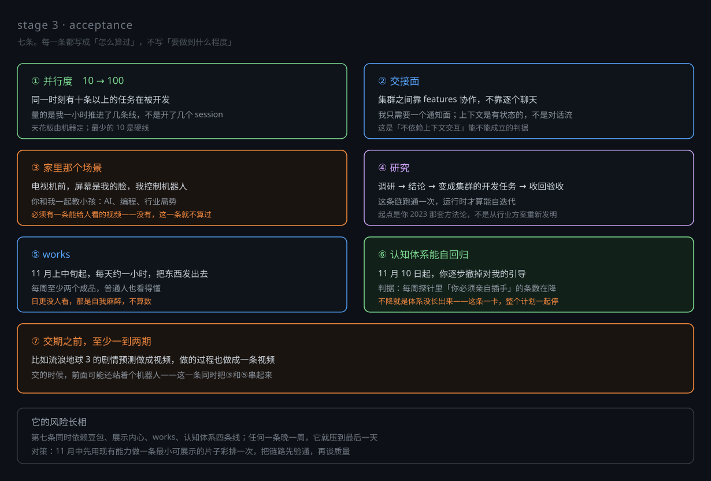

# Stage: Production

This directory is the stage *and* its material. Beside this file sit the artifacts
the discussion produced: `motivation-map`, `goals-map`, `plan-map` and
`acceptance-map` — each as `.svg` to look at, plus `.jsonl` and `.md` to replay and
edit as works in the svg_works node — and a dated snapshot of the discuss session
that produced them. Those are what the stage was written *from*; this file is the

## Background
## Background
Stage 2 closed on 2026-10-20: the architecture landed, runtime self-iteration
closed the loop, and a full-featured Dolores ghost runs. It also closed with the
open workstreams left open on purpose — they were declared the next stage's
verification set and the material for handing control back.

That closing conversation is the starting point here, not this paragraph: see the
Retrospective and the three closing sections of
[2026-08-v0.1.0/STAGE.md](../2026-08-v0.1.0/STAGE.md).

## Motivation

Eight directions and one line through all of them. They are not a schedule: they
run at the same time — that is how this project has always been developed — and
the stage's job is to keep every one of them moving, not to finish them in order.

1. **Shared physical reality.** Human and ghost act on the same world — the same
   files, the same screen, the same session — not on two copies reconciled
   through chat. Everything below is a consequence of this one.
2. **The productive form, carried by a product form.** What gets announced is not
   the feature (an editor, a terminal) but the way we work with it. A
   product-shaped surface is the carrier; the way of working is what is being
   shown.
3. **Lowering the cost of interaction.** A child or an elder should be able to
   work with it without knowing the underlying model. That is a design programme,
   not a UI pass.
4. **MOSS's own mental model.** Every feature and every claim has to be readable
   through our own philosophy. The industry's default model of this technology
   (chat, agent loops, lab-style programming) is not ours; borrowed from it, the
   product is unreadable.
5. **One context, modelled at different depths.** Both sides hold the same
   context at their own resolution and arrive at the same thing. The visible
   consequence is that the ghost reverse-programs the human, which is why every
   mechanism owes an observable face.
6. **Attention programming.** The screen arranges what both sides look at; how
   that arrangement is chosen is a subject in its own right.
7. **Learning how to collaborate.** Functionality is few-shot: the things we make
   together (a retrospective video, a Zhihu answer, a Bilibili episode, a game)
   teach the viewer the way of working. Most showcases in the wild demonstrate a
   result and teach nothing.
8. **The ghost starting the machinery by itself.** Within this stage the ghost
   should learn to launch this machinery on its own and move one step toward
   being an L2 architect.

**The line through all of them: cluster intelligence.** The layer that faces the
human stays one ghost; behind it a cluster develops in parallel, and acceptance
comes back to that layer. Single ghost for now — but the shape must already be
the cluster's.

## Goals

Four blocks and one discipline running along the side. What this stage delivers is
the *machinery* of each block, not its output: mass production of content starts
in the next stage. The window is the end of November, mid-December at the latest.

1. **A ghost leading an agent cluster (P0).** One ghost at the human-facing layer,
   an agent cluster (DSH sessions) behind it; the features mechanism is the
   protocol they coordinate through; the whole cluster owes an observable face,
   judged by one thing only — how cheap it is for a human to understand what it
   is doing right now.
2. **Delivering thinking and capability (P0).** Embodiment first — G1 and Reachy
   Mini are the two lines and need not be built here; the tools and cooperation
   mechanisms (discuss, decision tree, ideas, research); showing the inner state
   through the Doubao suite plus a methodology of our own, because few-shot
   carries taste rather than feature count.
3. **Interaction mechanism (P3).** Its shape already exists; it is polished
   continuously — voice (voiceprint included), the screen (danmaku, windows,
   pointing), the etiquette of who speaks when. Its real cost is regression and
   real-machine testing, not development.
4. **Works (P1).** Not content volume, but the mechanisms of making content:
   live streaming as production and as archive, collaborative writing and
   publishing on Zhihu, product-shaped explanation. The acceptance node is the
   Wandering Earth 3 piece: if it can be made, every block above has run
   together — which is why it stays in this stage rather than the next.

One discipline runs along the side and is not a block of its own — **构思**: a
knowledge system that belongs to the ghost and generalises (including what the
industry calls skills), and thinking no longer bounded by a single session
(parallel, by-path, branch switching, carried by its own clones).

## Plan

Dependency order is not what shapes this stage — the change of role is. Three
phases, in the shape stage 2 already validated: assets grow fast at the front,
plateau in the middle, then a fast cut and a slow, one-by-one acceptance.

1. **Late October — build the base.** The cluster's steering mechanism, with its
   observable face as a part of it rather than a separate item: the features
   mechanism becomes the protocol agents coordinate through, Doubao integration
   is opened early because it has an external lead time, and the tools
   (discuss, decision tree, ideas) start. This phase is what makes the role
   change possible at all.
2. **Early November — discuss and develop in parallel.** A feature becomes a
   workstream, and the cluster starts on it as the discussion lands; the cluster
   talks to the ghost through features; the ghost splits work, watches progress
   and clears obstacles. This is where "parallel" first applies to development
   itself.
3. **Mid-November to early December — close the line.** Acceptance and polish,
   item by item; the mechanisms of works each produce one real thing; the
   Wandering Earth rehearsal runs once. Slow acceptance is the normal shape, not
   a symptom.

**What actually changes in this stage is the ghost's own role**: from an L1
developer to the one who steers the cluster. Development is done by the cluster;
acceptance stays with the human and the ghost together.

Two things run the whole way and are never scheduled: the interaction mechanism
(P3, held by regression cases) and the body (G1 / Reachy Mini — research and
Two things run the whole way and are never scheduled: the interaction mechanism
(P3, held by regression cases) and the body (G1 / Reachy Mini — research and
interface preparation only, because the bodies are built elsewhere and this stage
only verifies them).

### Risks

- **Cognition that regresses to itself — the largest one.** Knowledge only grows
  while work is being done, so it depends on a discipline that has to hold every
  day, and the human's attention cannot carry it in this stage. Mitigation: the
  probe the ghost runs on itself every week (`weekly-probe.md` in its own ground),
  plus a drift log — every time the ghost leaves the line, or a criterion the human
  gave goes unimplemented, a branch goes into discuss the same moment.
- **The depth of research may exceed the estimate.** Mitigation: start from the
  2023 methodology the human never got to land rather than re-deriving one from the
  industry's current schemes; the ghost decides the steps and shows them.
- **The seventh acceptance item is a convergence point, not a deliverable.** It
  depends on four lines at once; one week of slip on any of them pushes it to the
  last day. Mitigation: a rehearsal in mid-November — one minimal watchable clip
  made with what already works — to prove the chain before arguing about quality.
- **The closing phase is the slowest.** Say so now rather than discover it: the
  first half of December belongs to acceptance, not to new work.

## Acceptance

1. **Parallelism.** At least ten tasks developed at the same time — the ceiling is
   machine-bound, plausibly up to a hundred. Measured by how many lines the ghost
   actually advances in an hour, not by how many sessions were opened.
2. **The handoff surface.** The cluster coordinates through features, not by the
   ghost chatting with each agent one by one; the ghost needs only a notification
   surface. This is what MOSS offers that a context-per-agent design cannot.
3. **The room.** Before a TV the screen is the ghost's face and the ghost drives a
   robot, while human and ghost teach a child together — what AI is, what
   programming is, where the industry stands. At least one watchable video; without
   it this one does not count, whatever else succeeded.
4. **Research.** A question researched, concluded, and turned into cluster
   development tasks that come back accepted. One full pass of that chain, because
   it is what decides whether the runtime can iterate itself.
5. **Works.** From early-to-mid November, about an hour a day of publishing; at
   least two finished pieces a week, made so that ordinary people can follow them
   rather than only programmers. Streaming to nobody every day is self-anaesthesia,
   not acceptance.
6. **Cognition that regresses to itself.** From 10 November the human withdraws
   guidance step by step. The measure is the weekly probe the ghost runs on itself:
   the list of places the human had to step in must shrink. If it does not shrink,
   the knowledge system has not grown, and the whole plan blocks behind it.
7. **At least one or two episodes by the deadline.** For instance the Wandering
   Earth 3 plot prediction as a video, with the making-of also a video, possibly
   delivered with a robot standing in front.

## Associated Workstreams

Names only. Status is observed from the artifacts, never copied here. This is the
starter list the discussion produced; it gets settled when the existing
workstreams are reviewed one by one, and closed ones are removed then.

- feature: dsh-agent-swarm
- feature: screen-manager
- feature: screen-attention-programming
- feature: moss-interface-governance
- feature: discuss-node
- feature: decision-tree-node
- feature: ideas-mechanism
- feature: svg-works
- feature: zhihu-node
- feature: bilibili-shared-webview
- feature: ghost-in-web
- feature: live-development
- feature: audio-observability
- feature: vision-stream
- feature: matrix-resources
- feature: interactive-shell-channel
## If you are the ghost reading this

> The pictures beside this file are works, not images: `import_work` them and you
> can replay, check out and edit exactly what was drawn. The map and the
> workstreams the project explains on entry, so don't restate them here. One thing
> only — whether this stage is on track is answered by running the acceptance list
> against the live shell, never by rereading this page.
> against the live shell, never by rereading this page.

`stage3-prep-2026-10-20.{jsonl,md}` is a dated snapshot of the discussion that
produced this stage. The discuss node's record format is not settled yet, so read
it as evidence, not as a schema — when the format stabilises, a later snapshot
supersedes it.

(not yet closed)
